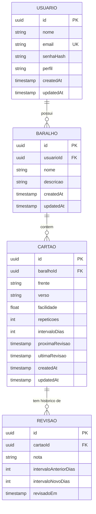
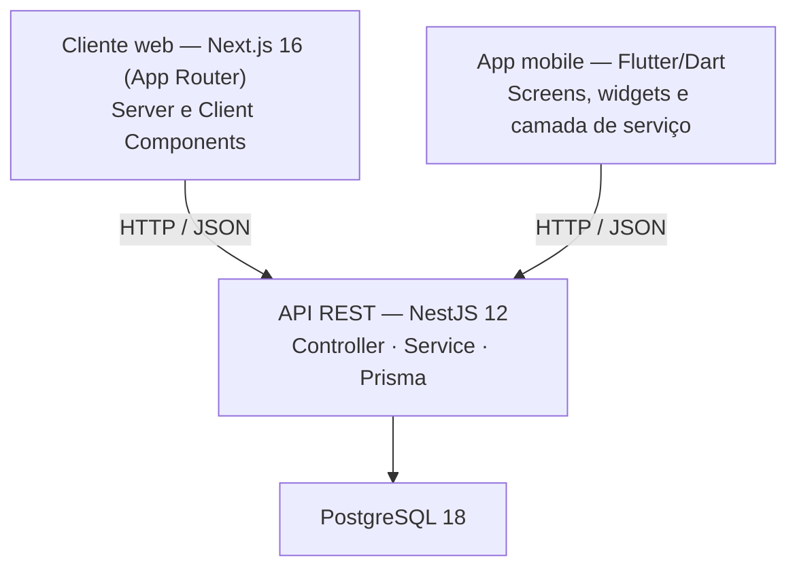

# PRD — Product Requirements Document

> **Instruções:** Este documento detalha os requisitos do sistema definido no Documento de Visão. Deve ser entregue ao final da **Etapa 1** e atualizado conforme o projeto evolui. Remova os blocos `> instrução` após preenchê-los.
>
> O contrato da API vive em documento separado: [`docs/contrato-api.md`](contrato-api.md). Este PRD define **o que** o sistema faz; o contrato define **como** os clientes conversam com ele.

---

## Identificação

| Campo | Valor |
|---|---|
| **Nome do projeto** | Memora |
| **Grupo** | Breno Olliari e Matheus Savegnago |
| **Versão do documento** | 1.2 |
| **Data de criação** | 21/09/2026 |
| **Última atualização** | 15/11/2026 |
| **Documento de Visão (ref.)** | `docs/visao.md` |
| **Contrato da API (ref.)** | `docs/contrato-api.md` |

---

## 1. Objetivo do produto

> Em no máximo 4 linhas, descreva o que o produto faz, para quem e qual problema resolve. Deve ser consistente com a seção 2.1 do Documento de Visão.

O Memora permite que estudantes criem baralhos de flashcards e os revisem com repetição espaçada: o sistema decide quando cada cartão volta a aparecer, com base em como o estudante avaliou a última revisão. O objetivo é fixar conteúdo com menos tempo de estudo do que a releitura, resolvendo o problema de não saber o que revisar nem quando.

> **Status do Checkpoint 1 (24/09/2026):** a entrega prioriza a API NestJS com persistência Prisma/PostgreSQL para baralhos, cartões, fila de estudo e revisões. A autenticação JWT, o cliente web, o app mobile, estatísticas e permissões administrativas ficam para etapas posteriores. Durante o desenvolvimento, a API usa um usuário técnico fixo, documentado no backend, apenas para exercitar os endpoints do MVP.

---

## 2. Personas

> Transforme os perfis de usuário da Visão em personas com mais detalhe. Ao menos 2. Registre em qual cliente cada persona passa a maior parte do tempo.

### Persona 1 — Marina

> Marina, 20 anos, estudante de Direito

- **Contexto:** Tem muita matéria para decorar (artigos, conceitos, prazos) e estuda em pedaços de tempo: no ônibus, entre aulas, na fila.
- **Cliente principal:** mobile
- **Objetivo principal no sistema:** Revisar os cartões do dia em poucos minutos, sem decidir o que estudar.
- **Maior frustração atual (sem o sistema):** Reler o caderno inteiro e ainda esquecer o que não revisou a tempo.
- **Critério de sucesso:** Abrir o app, ver quantos cartões estão pendentes e terminar a sessão em menos de 10 minutos.

### Persona 2 — Rafael

> Rafael, 28 anos, concurseiro

- **Contexto:** Estuda em casa, no computador, e transforma apostilas e resumos em perguntas e respostas. Cria muitos cartões de uma vez.
- **Cliente principal:** web
- **Objetivo principal no sistema:** Organizar o material em baralhos por matéria e acompanhar o próprio progresso.
- **Maior frustração atual (sem o sistema):** Planilhas e papel não avisam quando revisar cada assunto, e ele não sabe onde está mais fraco.
- **Critério de sucesso:** Ver, no fim da semana, quantas revisões fez e a taxa de acerto.

---

## 3. Requisitos funcionais

> Liste todos os requisitos funcionais organizados por módulo/épico. Use o identificador RF-XXX. Prioridade: **Alta** (MVP), **Média** (importante mas não bloqueia), **Baixa** (desejável).
>
> A coluna **Cliente** indica onde o requisito se manifesta na interface. Um mesmo requisito pode aparecer nos dois — mas se todos aparecerem nos dois, revise o recorte da seção 7.

### 3.1 Autenticação e sessão

> Entram aqui apenas os **comportamentos observáveis** de autenticação: o que o usuário faz e o que o sistema responde. As exigências de segurança que acompanham esses comportamentos ficam na seção 4, e quem pode fazer o quê fica na seção 5.

| ID | Descrição | Prioridade | Persona | Cliente |
|---|---|---|---|---|
| RF-001 | O usuário entra no sistema informando e-mail e senha e recebe acesso às funcionalidades do seu perfil | Alta | todas | web / mobile |
| RF-002 | O usuário encerra a sessão e deixa de ter acesso às rotas protegidas | Alta | todas | web / mobile |
| RF-003 | O visitante cria uma conta informando nome, e-mail e senha. A conta criada é sempre de estudante; após a confirmação de cadastro, entra pela tela de login. O administrador é criado por seed | Alta | Rafael | web |

### 3.2 Baralhos

| ID | Descrição | Prioridade | Persona | Cliente |
|---|---|---|---|---|
| RF-010 | O estudante cria um baralho com nome e descrição opcional | Alta | Rafael | web |
| RF-011 | O estudante vê a lista dos seus baralhos, cada um com total de cartões e quantidade de cartões pendentes | Alta | todas | web / mobile |
| RF-012 | O estudante edita o nome e a descrição de um baralho | Alta | Rafael | web |
| RF-013 | O estudante remove um baralho, com confirmação, e seus cartões são removidos junto | Alta | Rafael | web |

### 3.3 Cartões

| ID | Descrição | Prioridade | Persona | Cliente |
|---|---|---|---|---|
| RF-020 | O estudante cria um cartão em um baralho informando frente e verso | Alta | todas | web / mobile |
| RF-021 | O estudante lista e busca os cartões de um baralho | Alta | Rafael | web |
| RF-022 | O estudante edita a frente e o verso de um cartão sem perder o progresso dele | Alta | Rafael | web |
| RF-023 | O estudante remove um cartão | Alta | Rafael | web |

### 3.4 Estudo (repetição espaçada)

| ID | Descrição | Prioridade | Persona | Cliente |
|---|---|---|---|---|
| RF-030 | O estudante inicia uma sessão de estudo em um baralho e recebe os cartões pendentes, do mais atrasado ao menos atrasado | Alta | todas | web / mobile |
| RF-031 | Na sessão, o estudante vê a frente, revela o verso e avalia o cartão como "errei", "difícil", "bom" ou "fácil"; o sistema reagenda o cartão | Alta | todas | web / mobile |
| RF-032 | Após avaliar, o estudante vê em quantos dias o cartão volta | Média | Marina | web / mobile |
| RF-033 | Quando não há cartões pendentes, o sistema informa que não há nada para estudar hoje | Alta | todas | web / mobile |

### 3.5 Progresso e administração

| ID | Descrição | Prioridade | Persona | Cliente |
|---|---|---|---|---|
| RF-040 | O estudante vê o resumo do seu progresso: revisões de hoje, cartões pendentes, taxa de acerto da semana e sequência de dias | Média | Rafael | web |
| RF-050 | O administrador lista os usuários cadastrados em páginas no servidor, com nome, e-mail e perfil | Alta | administrador | web |
| RF-051 | O administrador abre o detalhe de um usuário e consulta os totais de baralhos, cartões e cartões pendentes, além do resumo, atividade e métricas por baralho das estatísticas | Alta | administrador | web |
| RF-052 | O administrador exclui outra conta após confirmar sua própria senha; o sistema bloqueia autoexclusão e remove baralhos, cartões e revisões em cascata | Alta | administrador | web |

---

## 4. Requisitos não funcionais

> Requisito não funcional descreve **como** o sistema se comporta, não o que ele faz: qualidade, restrição, atributo. As quatro primeiras linhas de segurança já vêm preenchidas porque valem para todos os projetos desta disciplina — ajuste os critérios de aceitação ao seu caso e complete o restante da tabela.

| ID | Categoria | Descrição | Critério de aceitação |
|---|---|---|---|
| RNF-001 | Segurança — credenciais | Senhas são armazenadas com hash e nunca em texto puro | Nenhuma senha legível no banco; a coluna guarda o hash |
| RNF-002 | Segurança — sessão | O acesso é feito por token JWT, com validade definida (1 hora) | Token expirado é recusado com `401` |
| RNF-003 | Segurança — rotas | Toda rota que não seja pública exige token válido; rotas administrativas exigem o perfil `administrador` | Requisição sem token ou com token inválido recebe `401`; perfil insuficiente recebe `403`; recurso de outro usuário nas rotas pessoais responde `404` |
| RNF-004 | Segurança — segredos | Chaves e credenciais ficam em variável de ambiente | Nenhum segredo versionado no repositório |
| RNF-005 | Desempenho | A fila de estudo e a listagem de baralhos respondem rápido com volume realista | `GET /baralhos/:id/estudo` responde em menos de 500 ms com 5.000 cartões no baralho (índice em `baralhoId` + `proximaRevisao`) |
| RNF-006 | Usabilidade | Avaliar um cartão exige poucas interações | No máximo 2 toques por cartão: revelar o verso e escolher a nota |
| RNF-007 | Manutenibilidade | Backend organizado em um módulo NestJS por recurso, com DTOs validados; tipos dos clientes derivados do contrato | Cada recurso do contrato tem um módulo correspondente; DTOs rejeitam campos desconhecidos |
| RNF-008 | Comportamento em rede instável _(mobile)_ | O app trata falha de rede sem travar nem perder a avaliação em andamento | Timeout de 15 s; em falha, mostra mensagem clara e permite tentar novamente, mantendo o cartão na tela |
| RNF-009 | Integridade | Avaliar um cartão grava a revisão e atualiza o cartão de forma atômica | Ambas as operações ocorrem na mesma transação do Prisma; nunca existe revisão sem o cartão atualizado, nem o contrário |

> **Por que autenticação aparece em três lugares.** É a dúvida mais comum ao preencher este documento, e a resposta é que ela tem três faces distintas:
>
> | Onde | O quê | Exemplo |
> |---|---|---|
> | Requisito funcional (seção 3.1) | O comportamento que o usuário observa | "o usuário entra com e-mail e senha" |
> | Requisito não funcional (esta seção) | A qualidade e a restrição desse comportamento | "a senha é guardada com hash e o token expira" |
> | Regra de negócio (seção 5) | Quem pode fazer o quê no domínio | "só o perfil bibliotecário cadastra livros" |
>
> Fazer login é algo que o sistema **faz** — por isso é funcional. Fazer login **com segurança** é uma qualidade de como ele faz — por isso é não funcional. Confundir os dois costuma produzir um PRD em que a segurança nunca é verificada, porque não virou critério de aceitação de ninguém.

---

## 5. Regras de negócio

> Liste as regras que governam o comportamento do sistema. Regras de negócio são diferentes de requisitos — elas descrevem restrições e políticas do domínio.
>
> **Toda regra listada aqui é implementada no backend.** A coluna final registra se algum cliente antecipa a validação por conveniência de interface — o que é permitido, desde que o servidor continue sendo a fonte da verdade.

| ID | Regra | Validação antecipada no cliente? |
|---|---|---|
| RN-001 | Todo cartão novo mantém facilidade 2.5, começa com 0 repetições e intervalo de 0 dias e já nasce pendente | não |
| RN-002 | Cada avaliação (`errei`, `dificil`, `bom`, `facil`) incrementa repetições e escolhe o intervalo fixo definido pelo contrato; facilidade e intervalos anteriores não são calculados pelo algoritmo SM-2 | não |
| RN-003 | A facilidade de um cartão nunca fica abaixo de 1.3 | não |
| RN-004 | Um cartão está pendente quando sua data de próxima revisão é menor ou igual ao momento atual | não |
| RN-005 | Editar frente ou verso de um cartão não reinicia seu progresso | não |
| RN-006 | Não pode haver dois baralhos com o mesmo nome para o mesmo usuário (sem diferenciar maiúsculas) | não |
| RN-007 | Remover um baralho remove seus cartões e revisões; remover um cartão remove suas revisões | sim — o cliente pede confirmação antes |
| RN-008 | A fila de estudo vem ordenada por `proximaRevisao` crescente e depois por `id`; a rota não aplica limite de quantidade | não |
| RN-009 | O histórico de revisões é imutável: cada avaliação gera um registro que não é editado nem removido isoladamente | não |
| RN-010 | A sequência de dias conta dias consecutivos com ao menos uma revisão, no fuso `America/Sao_Paulo` | não |
| RN-011 | O cadastro público sempre cria um usuário de perfil `estudante`; e-mail é único no sistema | sim — o formulário valida formato de e-mail e tamanho da senha (8 a 72) |

**Autorização — quem pode o quê.** As regras de acesso por perfil são regras de negócio: elas dizem o que cada papel do domínio tem direito de fazer. A tabela completa vive em `docs/contrato-api.md`, seção "Perfis e permissões", porque é lá que ela vira `403`. Registre aqui apenas as que não sejam óbvias a partir dos perfis:

| ID | Regra de autorização | Perfil |
|---|---|---|
| RN-A01 | Um usuário só acessa os próprios baralhos, cartões e revisões; o acesso a recurso de outro usuário responde `404` | todos, inclusive administrador |
| RN-A02 | Somente o administrador pode usar as rotas administrativas `/usuarios` para listar, consultar detalhes, estatísticas e baralhos de um usuário, ou excluir outra conta; estudante recebe `403` | administrador |
| RN-A03 | A exclusão administrativa valida no backend a senha do administrador autenticado; senha incorreta retorna `403`, autoexclusão retorna `409` | administrador |

---

## 6. Modelo de dados

> Descreva as principais entidades do sistema, seus atributos e relacionamentos. O diagrama deve corresponder ao `schema.prisma` do backend — se divergirem, um dos dois está errado.

### 6.1 Diagrama ER

> Substitua pelas entidades reais do seu domínio. Lembre-se da convenção: substantivo de domínio em português, sem acento no identificador.

Restrições do banco: `USUARIO.email` único; `BARALHO` único em (`usuarioId`, `nome`); exclusão em cascata de `BARALHO` para `CARTAO` e de `CARTAO` para `REVISAO`; índice em `CARTAO` (`baralhoId`, `proximaRevisao`) para a fila de estudo. `perfil` e `nota` são enums no Prisma (`estudante`/`administrador`; `errei`/`dificil`/`bom`/`facil`).

### 6.2 Descrição das entidades

| Entidade | Responsabilidade | Principais atributos |
|---|---|---|
| `Usuario` | Conta de acesso ao sistema | `nome`, `email`, `senhaHash`, `perfil` |
| `Baralho` | Agrupa cartões de um assunto; pertence a um usuário | `nome`, `descricao`, `usuarioId` |
| `Cartao` | Flashcard com o estado de repetição espaçada | `frente`, `verso`, `facilidade`, `repeticoes`, `intervaloDias`, `proximaRevisao`, `ultimaRevisao` |
| `Revisao` | Registro imutável de cada avaliação feita no estudo | `cartaoId`, `nota`, `intervaloAnteriorDias`, `intervaloNovoDias`, `revisadoEm` |

---

## 7. Recorte web/mobile

> **Seção obrigatória.** Distribua as funcionalidades entre os dois clientes e justifique. O critério da justificativa é o **contexto de uso** descrito na Visão, não a facilidade de implementação.

| Funcionalidade | Web | Mobile | Justificativa |
|---|---|---|---|
| Cadastro de conta (RF-003) | ✅ | ✅ | Ambos criam contas de estudante; o cadastro não autentica automaticamente |
| Login e logout (RF-001, RF-002) | ✅ | ✅ | Necessário nos dois clientes |
| CRUD de baralhos (RF-010, 012, 013) | ✅ | ✅ | Os fluxos de baralho também existem no app; a tela grande facilita a organização |
| Listar baralhos com pendentes (RF-011) | ✅ | ✅ | Ponto de partida para estudar nos dois clientes |
| Criar cartão (RF-020) | ✅ | ✅ | No celular, para registrar uma dúvida na hora em que ela aparece |
| Listar, buscar, editar e remover cartões (RF-021 a 023) | ✅ | ✅ | A manutenção está disponível nos dois clientes; o web é mais adequado para edição extensa |
| Sessão de estudo e avaliação (RF-030 a 033) | ✅ | ✅ | É o núcleo do produto; no celular é onde acontece a maior parte do estudo |
| Resumo de progresso (RF-040) | ✅ | ✅ | Há telas de estatísticas nos dois clientes; a validação ponta a ponta mobile continua pendente |
| Administração de usuários (RF-050 a RF-052) | ✅ | — | Lista paginada, detalhe com estatísticas e exclusão protegida por senha, restritos ao administrador |

**O que ficou de fora do web:** recursos colaborativos e compartilhados permanecem fora do escopo atual.

**Recorte mobile mínimo (1 a 3 casos de uso, com leitura e escrita na API):**
- **Estudar um baralho:** o usuário faz login, escolhe um baralho (lê `GET /baralhos`), recebe a fila (`GET /baralhos/:id/estudo`) e avalia cada cartão (`POST /cartoes/:id/revisoes`) — leitura e escrita.
- **Criar cartão rápido:** o usuário escolhe um baralho e cadastra frente e verso (`POST /baralhos/:baralhoId/cartoes`) — escrita.

---

## 8. Arquitetura da solução

### 8.1 Visão geral dos componentes

### 8.2 Estrutura dos três projetos

> A organização das pastas `backend/`, `web/` e `mobile/` é a que está no `README.md` da raiz. Não a repita aqui: registre apenas os **desvios** que o seu domínio exigir, com o motivo.

| Componente | Desvio em relação ao README | Motivo |
|---|---|---|
| Backend | nenhum | — |
| Cliente web | nenhum | — |
| App mobile | nenhum | — |

> Se não houver desvio, escreva "nenhum". Desvio sem motivo declarado vira dívida que ninguém lembra de onde veio.

### 8.3 Módulos e recursos do backend

> Liste os módulos que a API terá, um por recurso do domínio. É o que orienta o `nest g resource`.

| Módulo | Recurso do domínio | Endpoints previstos |
|---|---|---|
| `auth` | Autenticação (JWT, guards) | `POST /auth/registro`, `POST /auth/login`, `GET /auth/perfil`, `PATCH /auth/perfil`, `PATCH /auth/senha` |
| `usuarios` | `Usuario` | `GET /usuarios`, `GET /usuarios/:id`, `GET /usuarios/:id/estatisticas`, `GET /usuarios/:id/estatisticas/atividade`, `GET /usuarios/:id/baralhos`, `DELETE /usuarios/:id` |
| `baralhos` | `Baralho` | `GET/POST /baralhos`, `GET/PATCH/DELETE /baralhos/:id`, `GET /baralhos/:id/estudo` |
| `cartoes` | `Cartao` | `GET/POST /baralhos/:baralhoId/cartoes`, `GET/PATCH/DELETE /cartoes/:id` |
| `revisoes` | `Revisao` e algoritmo de repetição espaçada | `POST /cartoes/:id/revisoes` |
| `estatisticas` | Consultas agregadas (sem entidade própria) | `GET /estatisticas`, `GET /estatisticas/baralhos/:baralhoId`, `GET /estatisticas/atividade` |

### 8.4 Decisões técnicas por componente

| Componente | Decisão a tomar | Escolha do grupo | Justificativa |
|---|---|---|---|
| Backend | Estratégia de autenticação (JWT simples, com refresh) | JWT simples, 1 hora, sem refresh | Menor complexidade; o produto não exige sessões longas e o refresh fica fora do escopo |
| Backend | Formato de identificador (uuid, cuid, inteiro) | uuid | Não expõe quantidade de registros nem permite adivinhar ids sequenciais |
| Backend | Onde fica o algoritmo de repetição espaçada | Dentro do módulo `revisoes`, em uma função pura separada do acesso ao banco | Regra central do produto; função pura é fácil de testar com casos da tabela do contrato |
| Web | Fronteira Server / Client Components | Páginas e componentes interativos usam o App Router; telas que controlam sessão, tabelas e diálogos são Client Components | A interface depende de estado de autenticação, eventos e chamadas autenticadas |
| Web | Estratégia de cache | Chamadas autenticadas usam `no-store` | Os dados dependem da conta logada e mudam após operações |
| Mobile | Gerência de estado (`setState`, Provider, Riverpod, Bloc) | `setState` | Suficiente para o escopo do app |
| Mobile | Nível de autenticação e armazenamento do token | Login real e token persistido em `SharedPreferences` | A sessão é restaurada ao iniciar; o token continua exigido em toda requisição autenticada |

> **Gerência de estado:** `setState` é suficiente para o escopo esperado do app. Provider, Riverpod, Bloc ou similares são diferencial, não requisito.
>
> **Nível de autenticação do mobile:** escolha um dos três níveis abaixo e registre a escolha na tabela acima. Os três são aceitos — o que importa é a escolha estar declarada aqui.
>
> - **Completa** — JWT igual ao do cliente web: token persistido no dispositivo, expiração tratada, logout implementado.
> - **Simplificada** — login real contra a API, mas o token fica apenas em memória (perdido ao fechar o app).
> - **Simulada** — o app obtém um token de forma fixa (por exemplo, login automático com credencial fixa), sem tela de login.

### 8.5 Tecnologias e versões

| Tecnologia | Versão | Papel |
|---|---|---|
| Node.js | 24.18.0 na máquina de Breno; Matheus não registrou | Runtime do backend |
| NestJS | 12.0.1 | Framework da API |
| Prisma | 7.10.0 (com `@prisma/adapter-pg`) | ORM e migrations |
| PostgreSQL | 18 | Banco de dados |
| React | 19 | Biblioteca de interface |
| Next.js | 16.3.5 (App Router) | Framework do cliente web |
| Flutter / Dart | Flutter 3.47.8 / Dart 3.13.7 no ambiente registrado; o manifesto exige `^3.13.7` | Framework do app mobile |
| Docker | — | Banco de dados local |

---

## 9. Planejamento de sprints

> Distribua os requisitos funcionais entre as sprints de cada etapa, conforme o calendário da turma. Atualize esta seção conforme o projeto avança.
>
> Acrescente ou remova linhas conforme o número de sprints definido. Etapas 2, 3 e 4 podem se sobrepor — declare a sobreposição em vez de fingir que o trabalho é sequencial.

| Sprint | Etapa | Tema | Requisitos previstos | Responsáveis | Entregáveis |
|---|---|---|---|---|---|
| 1 | Etapa 1 | Contrato e fundação | — | Breno | PRD, contrato e backend em desenvolvimento (NestJS, Prisma, PostgreSQL no Docker) |
| 2 | Etapa 2 | Backend: núcleo | RF-010 a RF-013, RF-020 a RF-023, RF-030, RF-031 | Breno e Matheus | Baralhos, cartões, fila de estudo e revisões implementados |
| 3 | Etapa 2 / 3 | Backend: acesso + início do web | RF-001 a RF-003, RF-040, RF-050; web: login e baralhos | Matheus (auth); Breno (stats/web) | JWT, guards, estatísticas e integração inicial do backend |
| 4 | Etapa 3 | Web | RF-011, RF-021 a RF-023, RF-030 a RF-033, RF-040 | Breno | Telas de cartões, estudo e progresso implementadas |
| 5 | Etapa 4 | Mobile | RF-001 a RF-040 | Matheus | Telas e testes automatizados presentes; integração ponta a ponta com backend real pendente |
| 6 | Etapa 5 | Integração e fechamento | RF-001 a RF-052 | Breno e Matheus | Fechamento integrado continua pendente; o status mobile ainda requer validação com backend real |

> Os três checkpoints caem ao final das etapas 2, 3 e 4 — um por componente. Distribua as sprints de forma que cada etapa chegue ao seu checkpoint com o componente correspondente funcionando.

Sobreposição declarada: as sprints 2 e 3 (backend) se sobrepõem ao início do web, que trabalha contra o contrato antes de todos os endpoints existirem.

---

## 10. Critérios de aceite (MVP)

> Quais são as condições mínimas para considerar o projeto concluído? Liste os cenários principais. Ao menos um critério deve ser de integração — algo que só se verifica com os três componentes no ar.

- [x] Um estudante se cadastra, faz login e vê a lista de baralhos vazia
- [x] Um estudante cria um baralho e cadastra cartões nele
- [x] A sessão de estudo mostra os cartões pendentes; após avaliar, o cartão sai da fila e reaparece na data calculada pelo servidor
- [x] A avaliação fixa os intervalos implementados: errei 0, difícil 1, bom 3 e fácil 7 dias — implementado em `CartoesService.registrarRevisao`; coberto por teste em `cartoes.service.spec.ts`
- [x] Acessar o baralho de outro usuário resulta em `404`; estudante acessando rotas administrativas recebe `403`; requisição sem token recebe `401` — coberto pelos testes de isolamento, guard de papéis e autenticação existentes
- [x] Administrador lista usuários com paginação de servidor, consulta detalhe/estatísticas e exclui outra conta após validar a senha; senha incorreta recebe `403`, autoexclusão recebe `409` — implementado nos módulos de usuários e coberto por `usuarios.service.spec.ts` e `admin-routes.spec.ts`
- [ ] Remover um baralho remove os cartões dele — PENDENTE: confirmar remoção em cascata com PostgreSQL real
- [ ] Um registro criado pelo cliente web aparece corretamente no app mobile, e vice-versa
- [ ] O app apresenta um token válido à API e vê os mesmos dados do cliente web, qualquer que seja o nível de autenticação declarado

---

## 11. Fora do escopo (explícito)

> Liste o que foi deliberadamente excluído para manter o escopo viável dentro do prazo.

- Refresh token e recuperação/troca de senha
- Baralhos compartilhados ou públicos entre usuários
- Importação e exportação (CSV, Anki)
- Imagens e áudio nos cartões
- Modo offline e sincronização no app mobile
- Notificações push de lembrete
- Tags, categorias e mover cartões entre baralhos
- Algoritmos avançados de repetição espaçada, como SM-2 completo ou FSRS

---

## 12. Histórico de revisões

| Versão | Data | Descrição |
|---|---|---|
| 1.0 | 21/09/2026 | Versão inicial |
| 1.1 | 02/11/2026 | Versões, endpoints, plano de sprints, algoritmo e status de implementação alinhados ao código |
| 1.2 | 15/11/2026 | Requisitos administrativos e critérios de integração alinhados à implementação atual |
